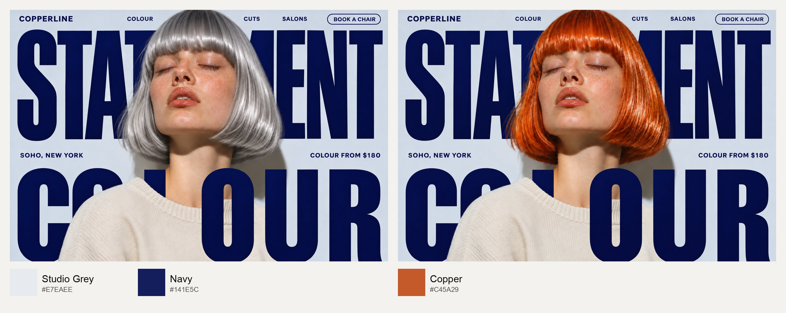

# accent-pages

A Claude Code skill that designs a landing-page hero twice: once in two quiet colours, once with **one accent colour**
from the opposite side of the colour wheel. Same page, same words. The only change is one colour.



## What you need
- [Claude Code](https://claude.com/claude-code)
- Python 3.9 or newer
- An OpenAI API key with access to image generation. Each image is one paid call; a finished pair is usually 3 to 4
  images. Check current prices on OpenAI's pricing page.

## Install
1. Download this repo into your skills folder:
   ```bash
   git clone https://github.com/Saurabhwashere/accent-pages ~/.claude/skills/accent-pages
   ```
   No git? Click **Code > Download ZIP** above, unzip it, and rename the folder to `accent-pages` inside
   `~/.claude/skills/` (Windows: `C:\Users\<you>\.claude\skills\`).
2. Install the two Python packages:
   ```bash
   python3 -m pip install requests pillow
   ```
3. In the folder where you want your designs, create a file named `.env` with one line:
   ```
   OPENAI_API_KEY=sk-your-key-here
   ```
   Keep this file private. Never share or commit it.

## Use
Open Claude Code in that folder and ask:

> Use accent-pages to design a hero for a cold-brew coffee brand.

Claude asks what you sell and who it is for, picks a palette, checks it, renders the accent page, then makes the plain
version and a side-by-side card with the three colour swatches.

## Examples
`examples/` has three finished pairs: Copperline (copper hair), Greenhold (green lettuce), Petalo (hibiscus pink can).

## License
MIT
